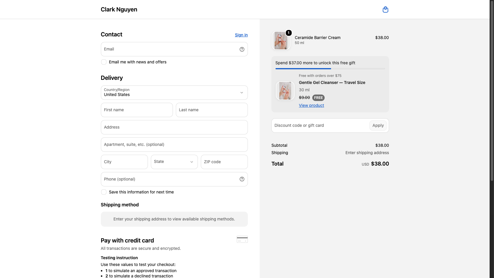
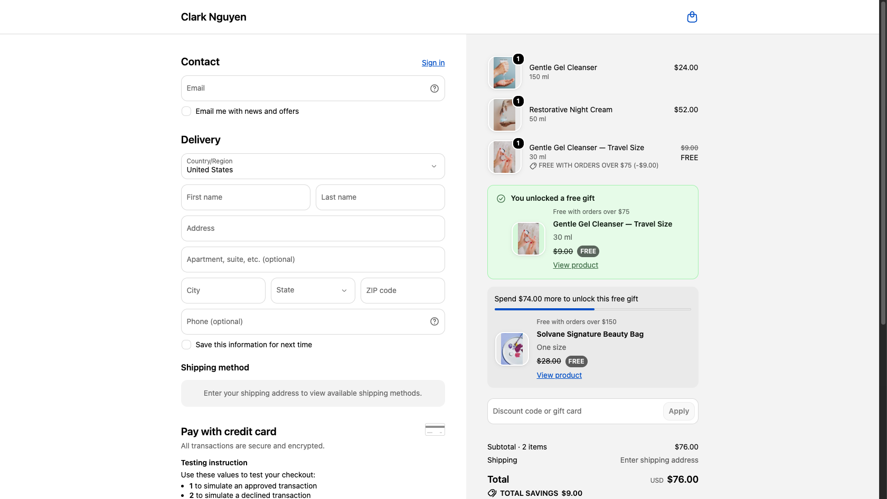
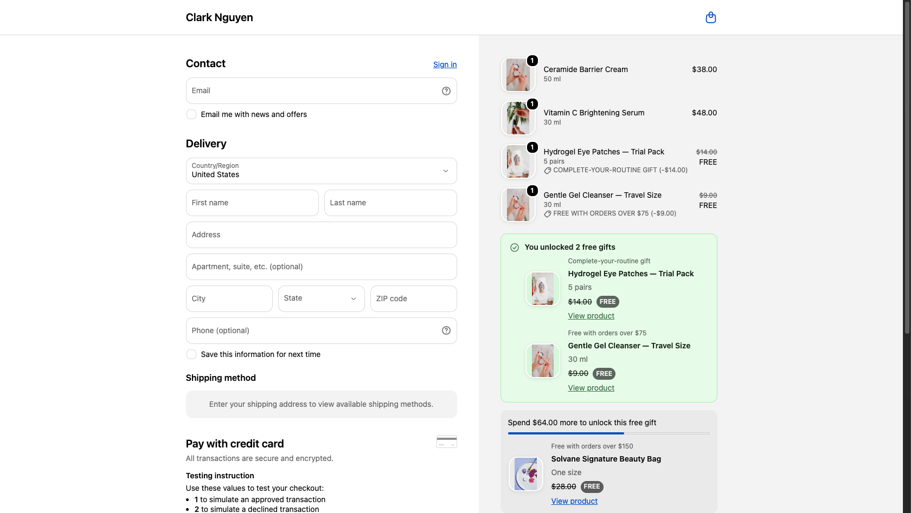
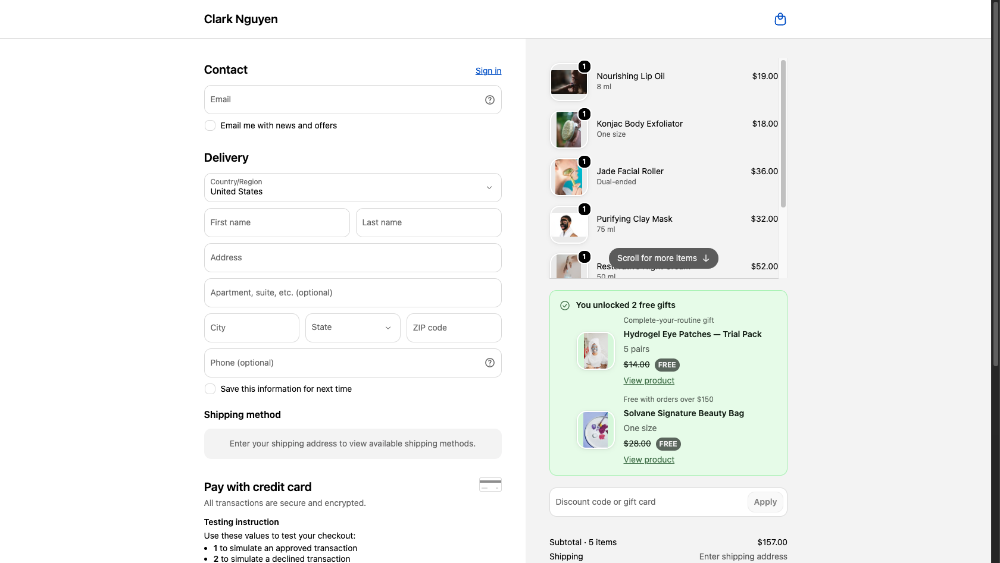
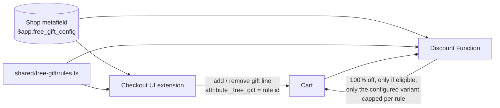
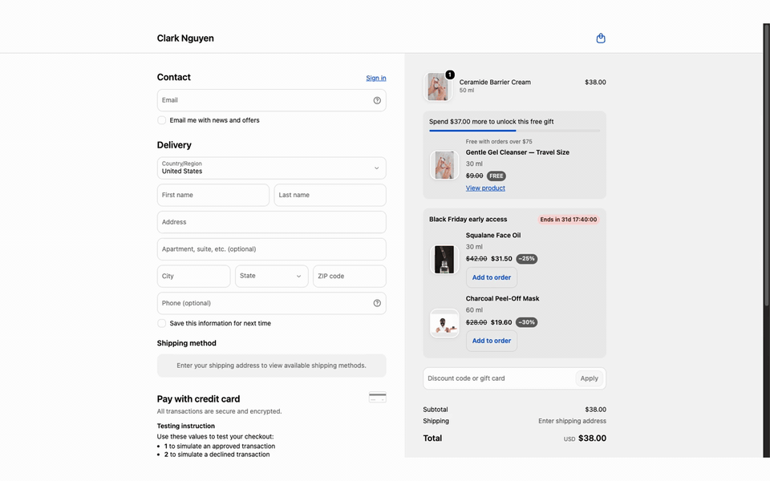
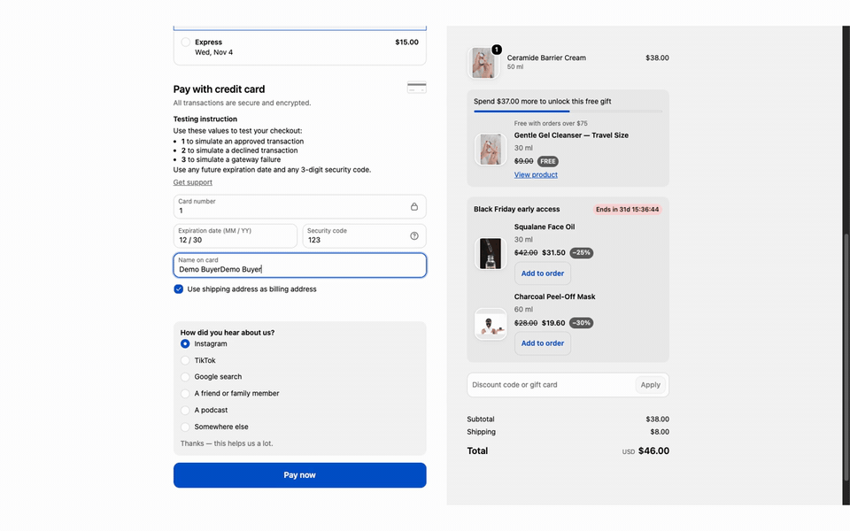
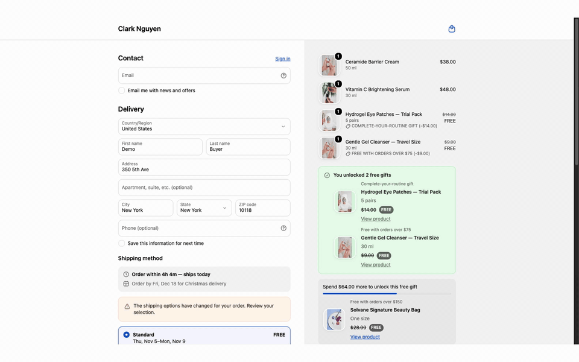
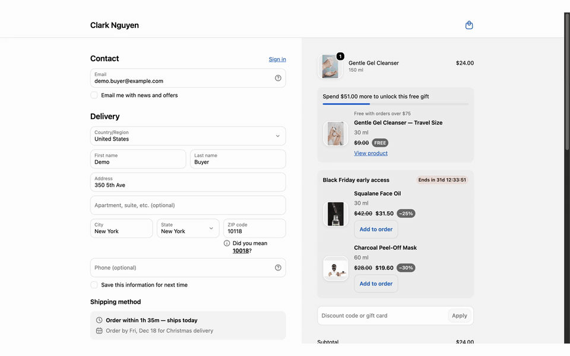

# Shopify Checkout Demos

Small, production-style demos of **Checkout UI Extensions** and **Shopify Functions**
(API 2026-10 for both the checkout extension and the Function, Preact + Polaris web components).

## 1. Rules-based free gift

A free gift that adds itself in checkout and **can't be abused**: the checkout extension
adds the gift line, and a discount Function independently re-checks the rules before
making it free. Every gift is shown as a product card — image, name, crossed-out price,
**FREE**, and a link to the product page — both once unlocked and as the next reward
under the "spend $X more" bar.

### ▶ Live demo

Shopify Plus development store. The first time, Shopify asks for the store password
**`ohsteg`** — enter it, then click the link again to land in checkout with that cart
(test store, no real payment).

The demo store sells **Solvane**, a fictional skincare brand (14 products in 6 collections,
US + EU markets).

| Try | Cart | What you should see |
|---|---|---|
| [Not there yet](https://clark-nguyen.myshopify.com/cart/53265036247322:1) | Ceramide Barrier Cream ($38) | "Spend $37.00 more" + the travel-size cleanser you'll unlock |
| [Tier 1](https://clark-nguyen.myshopify.com/cart/53265036280090:1,53265035952410:1) | Night Cream + Gel Cleanser ($76) | Travel cleanser added free; Beauty Bag shown as the next reward |
| [Complete your routine](https://clark-nguyen.myshopify.com/cart/53265036116250:1,53265036247322:1) | Vitamin C Serum + Ceramide Cream ($86) | Serum + moisturizer → eye-patch trial pack **and** the $75 gift |
| [Tier 2 + mask branch](https://clark-nguyen.myshopify.com/cart/53265036280090:1,53265035985178:1,53265037000986:1,53265037066522:1,53265037099290:1) | 5 items incl. a clay mask ($157) | Beauty Bag replaces the travel cleanser; routine gift via "$100+ with a mask" |
| [Exclusion](https://clark-nguyen.myshopify.com/cart/53265036116250:1,53265036247322:1,53265036935450:1) | Serum + cream + full-size eye patches ($120) | No eye-patch trial (they're already buying the full size) — $75 gift only |

| Under the threshold | Tier 1 unlocked |
|---|---|
|  |  |

| Complete your routine + tier 1 | Tier 2 + routine via the mask branch |
|---|---|
|  |  |

### What it handles

| Case | Example from the demo config |
|---|---|
| Spend threshold | $75+ → Gentle Gel Cleanser travel size |
| Tiers (best one wins) | $150+ → Signature Beauty Bag *instead of* the travel cleanser |
| Nested AND / OR / NOT | ((a serum **and** a moisturizer) **or** ($100+ **and** a mask)) **and not** full-size eye patches → eye-patch trial pack |
| Per-market thresholds | $75 / **€70** and $150 / **€140** — round local amounts instead of converted ones |
| Progress | "Spend $37.00 more to unlock this free gift" + the gift's product card |
| Cart changes | Gift removed when the cart stops qualifying; extra units trimmed; duplicate lines dropped |
| Config changes | Gift for a deleted rule or an old variant is removed and replaced |
| Abuse | A `_free_gift` attribute added by hand (Cart API, theme) gets **no** discount unless the cart really qualifies |
| Multi-currency | Market overrides first; otherwise the Function converts with `presentmentCurrencyRate`. The extension only acts in currencies whose thresholds it knows |
| Checkout limits | Respects cart instructions (`canAddCartLine` / `canRemoveCartLine`), e.g. accelerated checkouts |

### How it works



- **One rules engine** (`shared/free-gift/rules.ts`) — pure TypeScript, bundled into both the
  extension and the Function's wasm, so the UI and the price can't disagree.
- **One config** in an app-owned shop metafield (`$app` namespace), readable by both halves and
  writable only by the app.
- **Extension** (`extensions/free-gift-checkout`) — plans the cart changes, applies them one at a
  time (parallel cart changes trip checkout's change throttle), and re-plans from the real `lines`
  after every update instead of blindly retrying a failed call. Gift product cards come from one
  Storefront API query per config (`api_access`).
- **Function** (`extensions/free-gift-discount`) — `cart.lines.discounts.generate.run`; the
  source of truth for price.

### Rules format

```jsonc
{
  "version": 1,
  "currencyCode": "USD",
  "rules": [
    {
      "id": "spend-75",
      "title": "Free with orders over $75",
      "giftVariantId": "gid://shopify/ProductVariant/…",
      "group": "spend", "priority": 1,          // tiers: highest priority in a group wins
      "condition": {"type": "subtotal_at_least", "amount": 75, "amounts": {"EUR": 70}}
    }
  ]
}
```

Conditions: `subtotal_at_least`, `total_quantity_at_least`, `product_in_cart` (with
`minQuantity`), and the combinators `all`, `any`, `not`. Full example:
[`scripts/demo-config.json`](scripts/demo-config.json).

### Tests

```shell
npm test
```

- **37 unit tests** for the rules engine — every case above, plus mutation-checked (breaking the
  gift-line exclusion or the variant check makes the suite fail).
- **8 Function tests** that build the wasm and run it against fixtures: eligible, attribute added
  by hand, quantity capped, wrong variant, complex rule + tier, presentment currency, per-market override, no config.
- Manually verified on a Shopify Plus dev store (screenshots above), including the abuse case.

### Run it

```shell
npm install
shopify app dev --store <your-dev-store>

# write the rules (edit scripts/demo-config.json first: variant/product ids, currency)
shopify app execute --store <store> --query-file scripts/set-config.graphql \
  --variables '{"shopId":"gid://shopify/Shop/<id>","config":"<demo-config.json as a string>"}'

# create the automatic discount backed by the Function (once per store)
shopify app execute --store <store> --query-file scripts/create-discount.graphql
```

Then in the checkout editor open **Apps → free-gift-checkout → Add block** and save. After `shopify app deploy`, re-run `create-discount.graphql` if the discount was created against a dev preview (cleaning a dev preview deletes it).

### Known limits

- In checkout the extension has no exchange rate: it acts in the config currency and in markets
  with explicit amounts (`amounts.EUR`). The Function prices correctly in every currency.
- The EU market is configured but the dev store has no EU shipping zone yet, so EUR checkouts
  aren't live; EUR behaviour is covered by unit and Function tests.
- The extension compares line totals *after* line discounts, the Function *before* — so the
  extension is the stricter of the two and never adds a gift the Function won't make free.
- "Buyer removed the gift" is remembered for the current checkout only.

## 2. BFCM checkout offer — countdown + one-click add-ons



A Black Friday block in checkout: a live countdown to the end of the campaign and
discounted add-ons the buyer adds with one click. Adding an add-on can also unlock the
free gifts from demo 1 — the two features share the same cart.

**▶ [Try it](https://clark-nguyen.myshopify.com/cart/53265036247322:1)** (store password `ohsteg`) —
add the face oil, then the mask, and watch both free gifts unlock.

| Case | How |
|---|---|
| Countdown | Ticks every second to `endsAt` (exact time with offset) |
| One-click add | `applyCartLinesChange` adds the variant tagged `_bfcm_offer = <offer id>` |
| Price | A discount Function gives the offer's % off — only on the offer's variant, only up to `maxQuantity`, only between `startDate` and `endDate` in the **shop's timezone** (`shop.localTime.date`) |
| Abuse | A `_bfcm_offer` tag on another product, an unknown offer id, or a late checkout gets no discount |
| After the sale | The block disappears when the countdown ends; the Function stops discounting the next day (shop time) |

Config: [`scripts/bfcm-offer-config.json`](scripts/bfcm-offer-config.json) · logic: `shared/bfcm/offer.ts`
(14 unit tests) · Function fixtures: 5 wasm tests.

## 3. Post-purchase: attribution survey + referral code



**"How did you hear about us?" — stored on the order, no backend.** The thank-you page can't
write to an order, so the question sits right above **Pay now**. The answer is saved to a cart
metafield, and an order metafield definition with the `cart_to_order_copyable` capability
(declared in `shopify.app.toml`) copies it onto the order — verified on test order #1001
(`$app.attribution = "instagram"`).

**Referral block on the thank-you page.** A shareable code (`FRIENDS15`, 15% off, once per
customer — created by `scripts/create-referral-code.graphql`), a copy button
(`s-clipboard-item`) and a link that applies the code automatically (`/discount/<code>`).

| Detail | How |
|---|---|
| Survey answers | Fixed list + free text for "somewhere else" (trimmed, 80 chars max) |
| Accelerated checkouts | Skipped when `canSetCartMetafields` is false |
| Reading answers | Order metafield (merchant read access); apps reading orders need protected customer data access |
| Referral config | `{code, percentOff}` in an app-owned shop metafield (`scripts/referral-config.json`) |

Logic: `shared/attribution/survey.ts`, `shared/referral/referral.ts` (12 unit tests).

## 4. Shipping cut-off countdown + trust badges



**"Order within 2h 41m — ships today."** Above the shipping options, computed on the
**warehouse clock** (shop timezone), not the buyer's: weekends and holidays are skipped
(Wednesday evening before Thanksgiving → "ships Friday"), and a seasonal line counts down to
the last order date ("Order by Fri, Dec 18 for Christmas delivery"). DST-safe: local wall
times are converted to UTC in two passes.

**Trust badges under the payment methods**, worded by the merchant in the checkout editor
(extension settings — no redeploy to change the copy), with sensible defaults.

| Detail | How |
|---|---|
| Cut-off config | `scripts/shipping-cutoff-config.json` (timezone, cut-off time, ship days, holidays, seasonal deadline) |
| Timezone math | `Intl.DateTimeFormat` with the warehouse IANA zone; 12 unit tests incl. DST, holidays, UTC-vs-local midnight |
| Badge copy | 4 `single_line_text_field` settings; empty → localized default |

Logic: `shared/shipping/cutoff.ts`.

## 5. Gift funnel analytics — `analytics.publish` + a web pixel



**Which free gift actually moves the order value?** The free-gift block now tells the app's
web pixel what the buyer saw: a "spend $X more" nudge, a gift unlocked, a gift removed. The
pixel also hears `checkout_completed` and checks which gift lines were still in the order.

| Event | Sent when |
|---|---|
| `free_gift:progress_viewed` | the "spend $X more" card is shown (with the amount left) |
| `free_gift:unlocked` | a gift line is in the cart |
| `free_gift:declined` | the buyer removed a gift they qualified for |
| `checkout_completed` (standard) | the order is placed — gift lines found by their `_free_gift` property |

- **Once per checkout:** sent events are remembered in `shopify.storage`, so reloads and re-renders don't inflate the numbers.
- **No backend:** the pixel keeps running totals in the storefront's `localStorage` (`free_gift_funnel`): nudges, unlocks, keep rate and orders per gift, AOV with vs without a gift, per currency.
- **Optional collector:** set the pixel's `endpoint` to an HTTPS URL to also POST every event (GA4 proxy, Segment…); `none` keeps it local.
- **Privacy:** no personal data — rule ids, amounts and currency only.

Activate on a store: `shopify app execute --query-file scripts/activate-gift-pixel.graphql`.
Logic: `shared/analytics/gift-funnel.ts` (10 unit tests).

---

Built by **Clark (Chien) Nguyen** — Shopify app developer, Checkout Extensibility & Functions.
[Upwork](https://www.upwork.com/freelancers/~01d98f2acd2861ac4f) ·
[LinkedIn](https://www.linkedin.com/in/clark-nguyen-149413272/) ·
[dev.to](https://dev.to/chienit3bk)

Product photos: [Shopify Burst](https://www.shopify.com/stock-photos) (free for commercial use). Solvane is a fictional brand.
