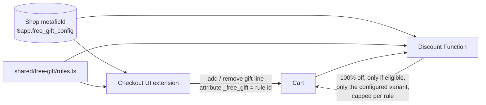

# Shopify Checkout Demos

Small, production-style demos of **Checkout UI Extensions** and **Shopify Functions**
(API 2026-10 / Functions 2026-07, Preact + Polaris web components).

## 1. Rules-based free gift

A free gift that adds itself in checkout and **can't be abused**: the checkout extension
adds the gift line, and a discount Function independently re-checks the rules before
making it free. Every gift is shown as a product card — image, name, crossed-out price,
**FREE**, and a link to the product page — both once unlocked and as the next reward
under the "spend $X more" bar.

### ▶ Live demo

Shopify Plus development store. The first time, Shopify asks for the store password
**`ohsteg`** — enter it, then click the link again to land in checkout with that cart
(test store, no real payment).

The demo store sells **Solvane**, a fictional skincare brand (14 products in 6 collections,
US + EU markets).

| Try | Cart | What you should see |
|---|---|---|
| [Not there yet](https://clark-nguyen.myshopify.com/cart/53265036247322:1) | Ceramide Barrier Cream ($38) | "Spend $37.00 more" + the travel-size cleanser you'll unlock |
| [Tier 1](https://clark-nguyen.myshopify.com/cart/53265036280090:1,53265035952410:1) | Night Cream + Gel Cleanser ($76) | Travel cleanser added free; Beauty Bag shown as the next reward |
| [Complete your routine](https://clark-nguyen.myshopify.com/cart/53265036116250:1,53265036247322:1) | Vitamin C Serum + Ceramide Cream ($86) | Serum + moisturizer → eye-patch trial pack **and** the $75 gift |
| [Tier 2 + mask branch](https://clark-nguyen.myshopify.com/cart/53265036280090:1,53265035985178:1,53265037000986:1,53265037066522:1,53265037099290:1) | 5 items incl. a clay mask ($157) | Beauty Bag replaces the travel cleanser; routine gift via "$100+ with a mask" |
| [Exclusion](https://clark-nguyen.myshopify.com/cart/53265036116250:1,53265036247322:1,53265036935450:1) | Serum + cream + full-size eye patches ($120) | No eye-patch trial (they're already buying the full size) — $75 gift only |

| Under the threshold | Tier 1 unlocked |
|---|---|
|  |  |

| Complete your routine + tier 1 | Tier 2 + routine via the mask branch |
|---|---|
|  |  |

### What it handles

| Case | Example from the demo config |
|---|---|
| Spend threshold | $75+ → Gentle Gel Cleanser travel size |
| Tiers (best one wins) | $150+ → Signature Beauty Bag *instead of* the travel cleanser |
| Nested AND / OR / NOT | ((a serum **and** a moisturizer) **or** ($100+ **and** a mask)) **and not** full-size eye patches → eye-patch trial pack |
| Per-market thresholds | $75 / **€70** and $150 / **€140** — round local amounts instead of converted ones |
| Progress | "Spend $37.00 more to unlock this free gift" + the gift's product card |
| Cart changes | Gift removed when the cart stops qualifying; extra units trimmed; duplicate lines dropped |
| Config changes | Gift for a deleted rule or an old variant is removed and replaced |
| Abuse | A `_free_gift` attribute added by hand (Cart API, theme) gets **no** discount unless the cart really qualifies |
| Multi-currency | Market overrides first; otherwise the Function converts with `presentmentCurrencyRate`. The extension only acts in currencies whose thresholds it knows |
| Checkout limits | Respects cart instructions (`canAddCartLine` / `canRemoveCartLine`), e.g. accelerated checkouts |

### How it works



- **One rules engine** (`shared/free-gift/rules.ts`) — pure TypeScript, bundled into both the
  extension and the Function's wasm, so the UI and the price can't disagree.
- **One config** in an app-owned shop metafield (`$app` namespace), readable by both halves and
  writable only by the app.
- **Extension** (`extensions/free-gift-checkout`) — plans the cart changes, applies them one at a
  time (parallel cart changes trip checkout's change throttle), and re-plans from the real `lines`
  after every update instead of blindly retrying a failed call. Gift product cards come from one
  Storefront API query per config (`api_access`).
- **Function** (`extensions/free-gift-discount`) — `cart.lines.discounts.generate.run`; the
  source of truth for price.

### Rules format

```jsonc
{
  "version": 1,
  "currencyCode": "USD",
  "rules": [
    {
      "id": "spend-75",
      "title": "Free with orders over $75",
      "giftVariantId": "gid://shopify/ProductVariant/…",
      "group": "spend", "priority": 1,          // tiers: highest priority in a group wins
      "condition": {"type": "subtotal_at_least", "amount": 75, "amounts": {"EUR": 70}}
    }
  ]
}
```

Conditions: `subtotal_at_least`, `total_quantity_at_least`, `product_in_cart` (with
`minQuantity`), and the combinators `all`, `any`, `not`. Full example:
[`scripts/demo-config.json`](scripts/demo-config.json).

### Tests

```shell
npm test
```

- **37 unit tests** for the rules engine — every case above, plus mutation-checked (breaking the
  gift-line exclusion or the variant check makes the suite fail).
- **8 Function tests** that build the wasm and run it against fixtures: eligible, attribute added
  by hand, quantity capped, wrong variant, complex rule + tier, presentment currency, per-market override, no config.
- Manually verified on a Shopify Plus dev store (screenshots above), including the abuse case.

### Run it

```shell
npm install
shopify app dev --store <your-dev-store>

# write the rules (edit scripts/demo-config.json first: variant/product ids, currency)
shopify app execute --store <store> --query-file scripts/set-config.graphql \
  --variables '{"shopId":"gid://shopify/Shop/<id>","config":"<demo-config.json as a string>"}'

# create the automatic discount backed by the Function (once per store)
shopify app execute --store <store> --query-file scripts/create-discount.graphql
```

Then in the checkout editor open **Apps → free-gift-checkout → Add block** and save. After `shopify app deploy`, re-run `create-discount.graphql` if the discount was created against a dev preview (cleaning a dev preview deletes it).

### Known limits

- In checkout the extension has no exchange rate: it acts in the config currency and in markets
  with explicit amounts (`amounts.EUR`). The Function prices correctly in every currency.
- The EU market is configured but the dev store has no EU shipping zone yet, so EUR checkouts
  aren't live; EUR behaviour is covered by unit and Function tests.
- The extension compares line totals *after* line discounts, the Function *before* — so the
  extension is the stricter of the two and never adds a gift the Function won't make free.
- "Buyer removed the gift" is remembered for the current checkout only.

---

Built by **Clark (Chien) Nguyen** — Shopify app developer, Checkout Extensibility & Functions.
[Upwork](https://www.upwork.com/freelancers/~01d98f2acd2861ac4f) ·
[LinkedIn](https://www.linkedin.com/in/clark-nguyen-149413272/) ·
[dev.to](https://dev.to/chienit3bk)

Product photos: [Shopify Burst](https://www.shopify.com/stock-photos) (free for commercial use). Solvane is a fictional brand.
