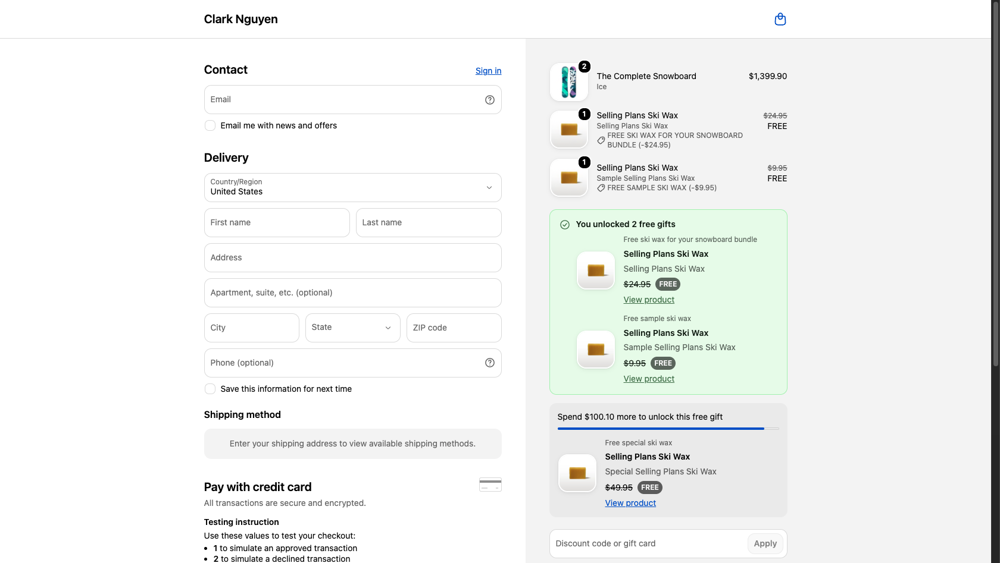
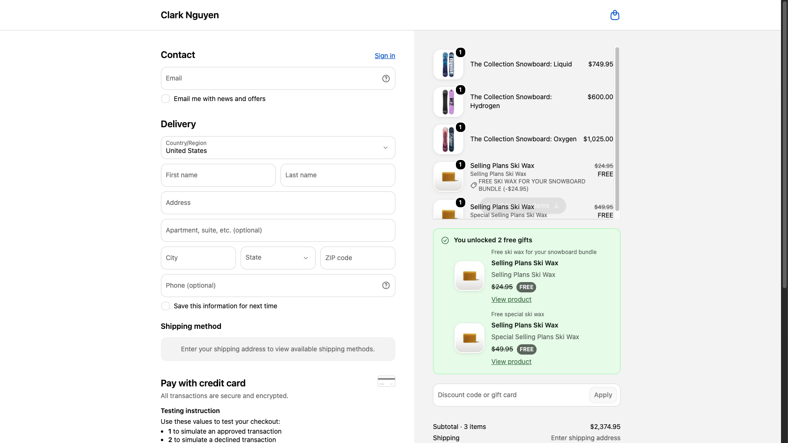
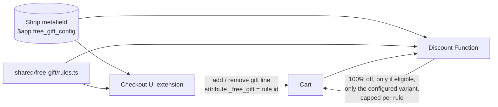

# Shopify Checkout Demos

Small, production-style demos of **Checkout UI Extensions** and **Shopify Functions**
(API 2026-10 / Functions 2026-07, Preact + Polaris web components).

## 1. Rules-based free gift

A free gift that adds itself in checkout and **can't be abused**: the checkout extension
adds the gift line, and a discount Function independently re-checks the rules before
making it free. Every gift is shown as a product card — image, name, crossed-out price,
**FREE**, and a link to the product page — both once unlocked and as the next reward
under the "spend $X more" bar.

### ▶ Live demo

Shopify Plus development store. The first time, Shopify asks for the store password
**`ohsteg`** — enter it, then click the link again to land in checkout with that cart
(test store, no real payment).

| Try | Cart | What you should see |
|---|---|---|
| [Not there yet](https://clark-nguyen.myshopify.com/cart/53264714432794:1) | $600 snowboard | "Spend $100.00 more" + the gift you'll unlock |
| [Tier 1](https://clark-nguyen.myshopify.com/cart/53264714858778:1) | $885.95 snowboard | Sample wax added for free, next tier shown |
| [Complex rule](https://clark-nguyen.myshopify.com/cart/53264714629402:2) | 2× Complete snowboard | Bundle wax + sample wax, both free |
| [Tier 2 + rule branch 2](https://clark-nguyen.myshopify.com/cart/53264715219226:1,53264714432794:1,53264715546906:1) | 3 snowboards, $2,374.95 | Special wax replaces sample wax; bundle wax via the "$2,000 + Hydrogen" branch |

| Under the threshold | Tier 1 unlocked |
|---|---|
|  |  |

| Complex rule + tier 1 | Tier 2 + complex rule ("$2,000 + Hydrogen" branch) |
|---|---|
|  |  |

### What it handles

| Case | Example from the demo config |
|---|---|
| Spend threshold | $700+ → free sample ski wax |
| Tiers (best one wins) | $1,500+ → special ski wax *instead of* the sample |
| Nested AND / OR / NOT | (2+ Complete snowboards **and not** a Multi-managed snowboard) **or** ($2,000+ **and** a Hydrogen snowboard) → bundle wax |
| Progress | "Spend $100.00 more to get Free sample ski wax" + progress bar |
| Cart changes | Gift removed when the cart stops qualifying; extra units trimmed; duplicate lines dropped |
| Config changes | Gift for a deleted rule or an old variant is removed and replaced |
| Abuse | A `_free_gift` attribute added by hand (Cart API, theme) gets **no** discount unless the cart really qualifies |
| Multi-currency | The Function converts with `presentmentCurrencyRate`; the extension stays idle outside the config currency |
| Checkout limits | Respects cart instructions (`canAddCartLine` / `canRemoveCartLine`), e.g. accelerated checkouts |

### How it works



- **One rules engine** (`shared/free-gift/rules.ts`) — pure TypeScript, bundled into both the
  extension and the Function's wasm, so the UI and the price can't disagree.
- **One config** in an app-owned shop metafield (`$app` namespace), readable by both halves and
  writable only by the app.
- **Extension** (`extensions/free-gift-checkout`) — plans the cart changes, applies them one at a
  time (parallel cart changes trip checkout's change throttle), and re-plans from the real `lines`
  after every update instead of blindly retrying a failed call. Gift product cards come from one
  Storefront API query per config (`api_access`).
- **Function** (`extensions/free-gift-discount`) — `cart.lines.discounts.generate.run`; the
  source of truth for price.

### Rules format

```jsonc
{
  "version": 1,
  "currencyCode": "USD",
  "rules": [
    {
      "id": "spend-700",
      "title": "Free sample ski wax",
      "giftVariantId": "gid://shopify/ProductVariant/…",
      "group": "spend", "priority": 1,          // tiers: highest priority in a group wins
      "condition": {"type": "subtotal_at_least", "amount": 700}
    }
  ]
}
```

Conditions: `subtotal_at_least`, `total_quantity_at_least`, `product_in_cart` (with
`minQuantity`), and the combinators `all`, `any`, `not`. Full example:
[`scripts/demo-config.json`](scripts/demo-config.json).

### Tests

```shell
npm test
```

- **31 unit tests** for the rules engine — every case above, plus mutation-checked (breaking the
  gift-line exclusion or the variant check makes the suite fail).
- **7 Function tests** that build the wasm and run it against fixtures: eligible, attribute added
  by hand, quantity capped, wrong variant, complex rule + tier, presentment currency, no config.
- Manually verified on a Shopify Plus dev store (screenshots above), including the abuse case.

### Run it

```shell
npm install
shopify app dev --store <your-dev-store>

# write the rules (edit scripts/demo-config.json first: variant/product ids, currency)
shopify app execute --store <store> --query-file scripts/set-config.graphql \
  --variables '{"shopId":"gid://shopify/Shop/<id>","config":"<demo-config.json as a string>"}'

# create the automatic discount backed by the Function (once per store)
shopify app execute --store <store> --query-file scripts/create-discount.graphql
```

Then in the checkout editor open **Apps → free-gift-checkout → Add block** and save. After `shopify app deploy`, re-run `create-discount.graphql` if the discount was created against a dev preview (cleaning a dev preview deletes it).

### Known limits

- Rule amounts are in one currency; the extension only acts when the buyer pays in it
  (the Function still prices correctly in any currency).
- The extension compares line totals *after* line discounts, the Function *before* — so the
  extension is the stricter of the two and never adds a gift the Function won't make free.
- "Buyer removed the gift" is remembered for the current checkout only.

---

Built by **Clark (Chien) Nguyen** — Shopify app developer, Checkout Extensibility & Functions.
[Upwork](https://www.upwork.com/freelancers/~01d98f2acd2861ac4f) ·
[LinkedIn](https://www.linkedin.com/in/clark-nguyen-149413272/) ·
[dev.to](https://dev.to/chienit3bk)
